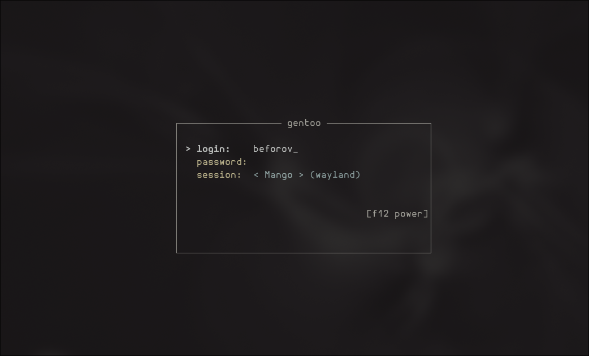

# rlogin

A fast, lightweight, and keyboard-driven TUI login manager for Linux inspired by **Ly** and **agetty**.



## Features

- **Minimalist TUI**: Clean interface built with Ratatui and Crossterm, free of visual clutter.
- **Auto-Detection**:
  - Automatically lists interactive users from `/etc/passwd`.
  - Discovers Wayland and X11 desktop sessions (`/usr/share/wayland-sessions/`, `/usr/share/xsessions/`).
  - Fallback to standard login shell (`/bin/sh -l`).
- **Standard Linux PAM**: Authenticates via `/etc/pam.d/login` (configurable).
- **Clean privilege drop**: Uses `setsid`, `initgroups`, `setgid`, `setuid` and properly populates `XDG_*` environment variables.
- **Init support**: Service configurations provided for **OpenRC**, **systemd**, and **inittab**.
- **Compact & Fast**: Standalone binary with zero bloat.

## Controls

| Key | Action |
| --- | --- |
| `Tab` / `Down` | Next field |
| `Shift+Tab` / `Up` | Previous field |
| `Left` / `Right` | Cycle users / sessions |
| `Enter` | Submit login |
| `F12` or `Ctrl+P` | Power menu (poweroff / reboot) |
| `Esc` | Clear input / close menu |

## Installation

### Build from source
Requires Rust 1.75+ and PAM development headers (e.g. `sys-libs/pam` on Gentoo, `pam` on Arch):

```bash
cargo build --release
sudo cp target/release/rlogin /usr/local/bin/rlogin
```

### Configuration (Optional)
Place a configuration file in `/etc/rlogin.toml` or `./config.toml`:

```toml
# PAM service to use (default: "login")
pam_service = "login"

# Custom banner title (defaults to system hostname)
# banner = "gentoo"

# Pre-select user or session
# default_user = "user"
# default_session = "Mango"

# Automatically clear fields on error
clear_password_on_error = true
clear_username_on_error = false
```

## Running as a Service

### OpenRC (Gentoo / Alpine / Artix)
```bash
sudo cp init/rlogin.openrc /etc/init.d/rlogin
sudo chmod +x /etc/init.d/rlogin
sudo rc-update add rlogin default
sudo rc-service rlogin start
```

### systemd
```bash
sudo cp init/rlogin.service /etc/systemd/system/
sudo systemctl daemon-reload
sudo systemctl disable getty@tty2.service
sudo systemctl enable --now rlogin.service
```

### Inittab / SysVinit
Add to `/etc/inittab`:
```text
c2:2345:respawn:/usr/local/bin/rlogin --tty 2 < /dev/tty2 > /dev/tty2 2>&1
```

## License
MIT
